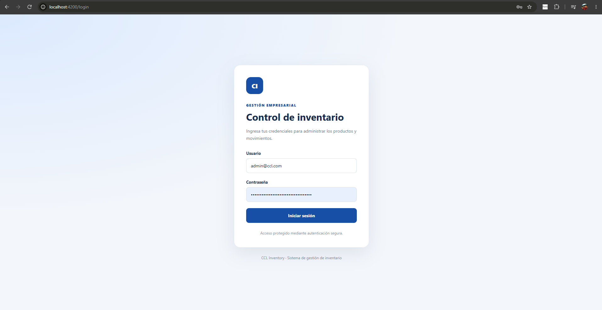
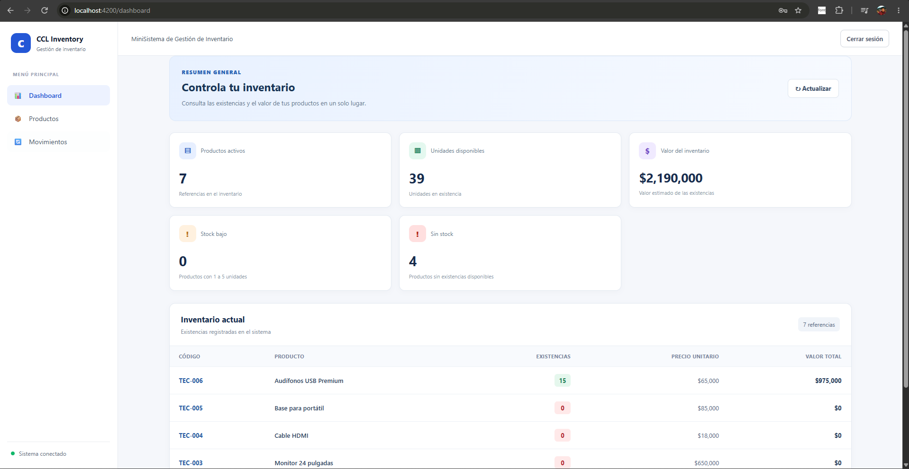
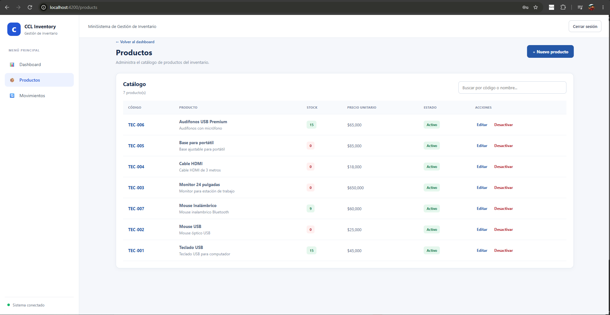
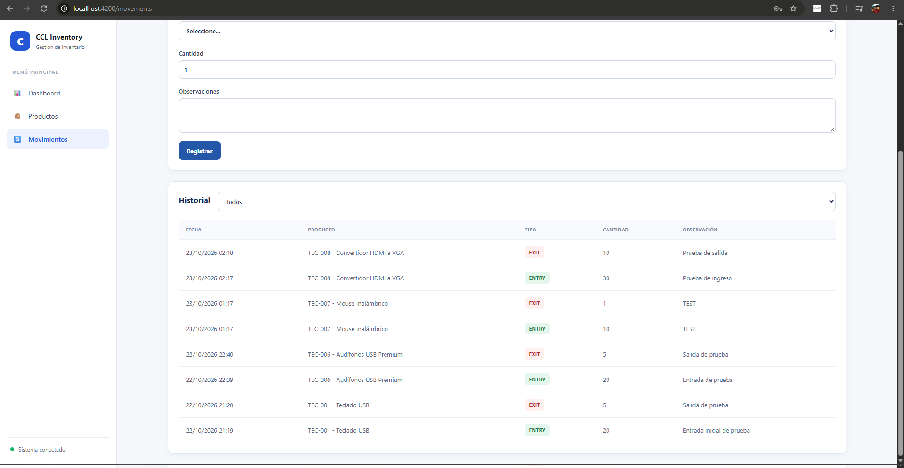
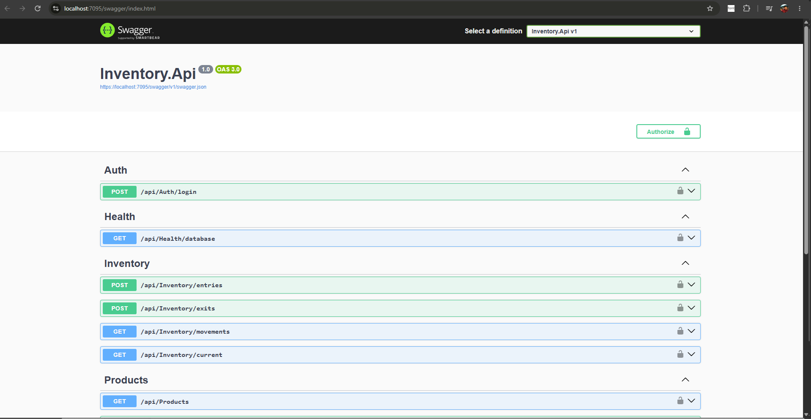

# CCL Inventory Management

Sistema web para la gestión de productos, inventario y movimientos de entrada y salida de mercancía, desarrollado como solución para una prueba técnica.

La aplicación permite administrar el catálogo de productos, registrar movimientos de inventario, consultar existencias actuales y visualizar el historial de movimientos. El backend expone una API REST protegida mediante autenticación JWT y utiliza PostgreSQL como motor de base de datos.

## 1. Tecnologías utilizadas

### Backend
- C# y ASP.NET Core Web API sobre .NET 8.
- Entity Framework Core.
- PostgreSQL.
- Npgsql como proveedor de conexión a PostgreSQL.
- Autenticación y autorización mediante JWT.
- Manejo centralizado de excepciones.

### Frontend
- Angular 20.
- TypeScript.
- HTML y SCSS.
- Servicios HTTP para consumir la API REST.
- Interceptor HTTP para adjuntar el token de autenticación.
- Protección de rutas mediante guard.

### Base de datos
- PostgreSQL.
- Tablas relacionales con llaves primarias y foráneas.
- Restricciones para validar cantidades y existencias.
- Procedimientos almacenados para registrar entradas y salidas.
- Función para consultar el inventario actual.

## 2. Funcionalidades implementadas

### Autenticación
- Inicio de sesión con usuario y contraseña de demostración.
- Generación y validación de tokens JWT.
- Protección de las funcionalidades privadas.
- Cierre de sesión.

### Productos
- Consultar el catálogo de productos.
- Crear productos.
- Consultar y editar productos.
- Desactivar productos mediante eliminación lógica.
- Validar los datos ingresados y manejar errores de negocio.

### Gestión de inventario
- Registrar entradas de mercancía.
- Registrar salidas de mercancía.
- Validar que la cantidad de una salida no supere las existencias disponibles.
- Consultar el inventario actual.
- Consultar el historial de movimientos.
- Filtrar movimientos por producto.
- Visualizar indicadores de productos, unidades, valor del inventario y existencias bajas o agotadas.

## 3. Estructura del proyecto

La solución se organiza en un repositorio que contiene el frontend, el backend, los scripts de base de datos y la documentación.

```text
ccl-inventory-management/
├── backend/
│   └── src/
│       └── Inventory.Api/
├── frontend/
├── database/
│   └── scripts/
│       ├── 01_schema.sql
│       ├── 02_stored_procedures.sql
│       └── 03_seed_data.sql
├── docs/
│   └── screenshots/
└── README.md
```

## 4. Requisitos previos

Antes de ejecutar el proyecto, se deben instalar las siguientes herramientas:

- Git.
- .NET SDK 8.
- Node.js y npm compatibles con la versión de Angular utilizada.
- Angular CLI 20.
- PostgreSQL.
- Un cliente para administrar PostgreSQL, como pgAdmin, o una herramienta equivalente.

Se recomienda verificar las instalaciones desde una terminal:

```bash
git --version
dotnet --version
node --version
npm --version
ng version
```

La API se ejecuta localmente y el frontend Angular se sirve mediante el servidor de desarrollo.

## 5. Descargar el proyecto

Clonar el repositorio:

```bash
git clone https://github.com/YaragSerdna/ccl-inventory-management.git
cd ccl-inventory-management
```

## 6. Configuración de la base de datos

### 6.1. Crear la base de datos

Desde pgAdmin o una herramienta equivalente, crear una base de datos llamada:

```text
ccl_inventory_db
```

También puede crearse mediante SQL:

```sql
CREATE DATABASE ccl_inventory_db;
```

### 6.2. Ejecutar los scripts

Ejecutar los scripts ubicados en `database/scripts/`, en el siguiente orden:

1. `01_schema.sql`: crea las tablas, restricciones e índices necesarios.
2. `02_stored_procedures.sql`: crea los procedimientos de entrada y salida y la función de consulta del inventario.
3. `03_seed_data.sql`: registra productos de demostración para facilitar las pruebas.

Los scripts deben ejecutarse sobre la base de datos `ccl_inventory_db`.

### 6.3. Configurar la conexión

La API utiliza una cadena de conexión a PostgreSQL. Debe configurarse con el servidor, puerto, base de datos, usuario y contraseña correspondientes al entorno local.

Ejemplo de cadena de conexión:

```text
Host=localhost;Port=5432;Database=ccl_inventory_db;Username=postgres;Password=REEMPLAZAR_CON_LA_CLAVE_LOCAL
```

La contraseña debe reemplazarse por la del usuario configurado en PostgreSQL.

## 7. Configuración del backend

Abrir una terminal en la carpeta de la API:

```bash
cd backend/src/Inventory.Api
```

Configurar los secretos locales mediante User Secrets de .NET. Si el proyecto todavía no tiene inicializado User Secrets, ejecutar una sola vez:

```bash
dotnet user-secrets init
```

Configurar la conexión a la base de datos:

```bash
dotnet user-secrets set "ConnectionStrings:DefaultConnection" "Host=localhost;Port=5432;Database=ccl_inventory_db;Username=postgres;Password=REEMPLAZAR_CON_LA_CLAVE_LOCAL"
```

Configurar los parámetros JWT:

```bash
dotnet user-secrets set "Jwt:Key" "CCL-Inventory-Demo-Secret-Key-2026-ChangeMe-At-Least-32-Chars"
dotnet user-secrets set "Jwt:Issuer" "CCL.Inventory.Api"
dotnet user-secrets set "Jwt:Audience" "CCL.Inventory.Client"
```

Configurar las credenciales de demostración:

```bash
dotnet user-secrets set "Jwt:DemoUser" "admin@ccl.com"
dotnet user-secrets set "Jwt:DemoPassword" "CclDemo2026!"
```

Los valores anteriores corresponden a una configuración local de demostración. La clave JWT es pública en este ejemplo y no debe utilizarse en producción.

*Importante:* estas instrucciones configuran los valores que consulta el controlador de autenticación. Si se modifican las credenciales, se debe utilizar el nuevo usuario y contraseña al iniciar sesión

### 7.1. Restaurar dependencias y ejecutar la API

Desde `backend/src/Inventory.Api`:

```bash
dotnet restore
dotnet build
dotnet run
```

Al iniciar la API, la consola mostrará las direcciones locales en las que está escuchando. Registrar la dirección HTTPS correspondiente, ya que el frontend debe consumir esa URL.

### 7.2. Swagger

Con la API en ejecución, abrir la ruta de Swagger indicada por el proyecto, normalmente:

```text
https://localhost:<PUERTO_HTTPS>/swagger
```

Reemplazar `<PUERTO_HTTPS>` por el puerto que muestre la consola.

Swagger permite consultar los endpoints disponibles y probar las operaciones de la API.

## 8. Configuración y ejecución del frontend

Abrir una segunda terminal y entrar a la carpeta del frontend:

```bash
cd frontend
```

Instalar las dependencias:

```bash
npm install
```

Verificar que la URL base configurada en los servicios de Angular corresponda a la dirección HTTPS real de la API. Si la API utiliza un puerto diferente al esperado, actualizar la configuración del frontend antes de ejecutarlo.

Iniciar Angular:

```bash
npm start
```

Si el proyecto no tiene definido el script `start`, ejecutar:

```bash
npx ng serve
```

Abrir en el navegador:

```text
http://localhost:4200
```

Para utilizar la aplicación, mantener abiertas las terminales del backend y del frontend.

## 9. Credenciales de demostración

Si se han configurado los valores de demostración de este documento y el servicio de autenticación los utiliza, iniciar sesión con:

| Campo | Valor |
|---|---|
| Usuario | `admin@ccl.com` |
| Contraseña | `CclDemo2026!` |

Cuando las credenciales son válidas, la API genera un token JWT con una vigencia de 60 minutos. El frontend utiliza ese token para consumir los endpoints protegidos.

Si la autenticación no está configurada, la API devuelve un error indicando que faltan las credenciales de demostración. Si el usuario o la contraseña no coinciden, responde con 401 Unauthorized.

## 10. Endpoints principales de la API

Los endpoints se encuentran organizados por funcionalidad:

| Método | Endpoint | Descripción |
|---|---|---|
| POST | `/api/Auth/login` | Autenticar al usuario y obtener un token JWT. |
| GET | `/api/Products` | Consultar productos. |
| GET | `/api/Products/{id}` | Consultar un producto por identificador. |
| POST | `/api/Products` | Crear un producto. |
| PUT | `/api/Products/{id}` | Actualizar un producto. |
| DELETE | `/api/Products/{id}` | Desactivar un producto. |
| POST | `/api/Inventory/entries` | Registrar una entrada de inventario. |
| POST | `/api/Inventory/exits` | Registrar una salida de inventario. |
| GET | `/api/Inventory/movements` | Consultar el historial de movimientos. |
| GET | `/api/Inventory/current` | Consultar el inventario actual. |
| GET | `/api/Health/database` | Verificar la conectividad con la base de datos. |

Las operaciones protegidas requieren el encabezado de autorización con un token válido:

```text
Authorization: Bearer <TOKEN_JWT>
```

Consultar Swagger para verificar los parámetros, cuerpos de solicitud y respuestas de cada operación.

## 11. Reglas de negocio y validaciones

- Las cantidades de los movimientos deben ser mayores que cero.
- No se permite registrar salidas superiores al inventario disponible.
- Las operaciones de entrada y salida actualizan las existencias y registran el movimiento correspondiente.
- La base de datos aplica restricciones de integridad sobre los productos y movimientos.
- Los productos se desactivan mediante eliminación lógica.
- Las operaciones privadas requieren autenticación.
- Los errores no controlados se procesan mediante el mecanismo centralizado de manejo de excepciones.

## 12. Evidencias de funcionamiento

Las capturas de pantalla se encuentran en `docs/screenshots/` y muestran las principales funcionalidades implementadas.

### Inicio de sesión



### Dashboard de inventario



### Gestión de productos



### Registro y consulta de movimientos



### Documentación de la API




## 13. Autoría

Proyecto desarrollado como parte de una prueba técnica para demostrar conocimientos en desarrollo backend con C# y .NET, frontend con Angular, persistencia de datos en PostgreSQL, diseño de API REST y autenticación basada en JWT.
